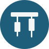

<div align="center">



# Ploutos

**Un bot de trading spot de cripto con unas reglas de riesgo que nadie puede saltarse,
y la historia honesta de buscarle una estrategia que gane.**


</div>

---

Ploutos (Πλοῦτος, el dios griego de la riqueza) es un **experimento**, no un producto: un bot que opera solo en OKX
(BTC y ETH contra euro), diseñado para escalar a 10.000 €, dentro de unas reglas deterministas que ni la IA ni
nadie puede cambiar desde el código.

La infraestructura está hecha y probada: ingesta de datos, motor de riesgo, órdenes con su protección en el
exchange, papel, panel, Telegram, copias y jueces automáticos. **Lo que no hay todavía es una estrategia que haya
demostrado ganar.** Este repositorio enseña las dos cosas: lo que funciona y lo que no.

> [!WARNING]
> Proyecto personal de experimentación y aprendizaje. **No es asesoramiento financiero** ni una recomendación de
> inversión. No hay dinero real en juego: todo es papel.

## Contenido

- [En qué punto está](#en-qué-punto-está)
- [Lo que dicen los datos, sin maquillar](#lo-que-dicen-los-datos-sin-maquillar)
- [Cómo se trabaja ahora](#cómo-se-trabaja-ahora)
- [Las reglas que nadie puede tocar](#las-reglas-que-nadie-puede-tocar)
- [Cómo está hecho](#cómo-está-hecho)
- [Empezar](#empezar)
- [Los servicios](#los-servicios)
- [Jueces: cada criterio tiene quien lo vigile](#jueces-cada-criterio-tiene-quien-lo-vigile)
- [Seguridad](#seguridad)
- [Estructura](#estructura)
- [Los estudios](#los-estudios)
- [Licencia](#licencia)

## En qué punto está

<sub>Octubre de 2026.</sub>

**En pausa, replanteando la estrategia.** El error de fondo fue construir toda la infraestructura antes de tener
una estrategia con ventaja, y después buscarla con prisa. Ahora se rehace en orden (ver
[Cómo se trabaja ahora](#cómo-se-trabaja-ahora)).

| Pieza | Estado |
|---|---|
| Ingesta, motor de riesgo, panel, Telegram, copias | ✅ hechos y en marcha |
| Ejecución en la cuenta demo de OKX | ✅ probada una semana sin descuadres; retirada al acabar |
| La IA eligiendo entre setups contra una regla fija | ⏹️ retirada sin veredicto: los setups pierden, así que la pregunta dejó de importar |
| **L**, rotación semanal de tendencia, en papel | 🔄 del 12/10/2026 al 11/01/2027, solo como información (ya no es candidata) |
| El estudio nuevo (BTC y ETH en euros) | 🔄 criterio fijado antes de medir; el simulador, hecho y validado; se mide a partir del 30/10 |
| Una estrategia que gane | ❌ ninguna todavía |
| Dinero real | ⏳ solo si una estrategia pasa |

## Lo que dicen los datos, sin maquillar

Un bot que dice ganar sin enseñar cómo lo sabe no dice nada. Lo medido:

| Prueba | Resultado |
|---|---|
| Los 3 setups de 4 h, último año contra USDC | **−0,38 R** por operación: pierden |
| Cinco ideas para mejorarlos, cortos, operaciones de 1 h | ninguna pasa |
| Un modelo de predicción de velas (Kronos) | no acierta |
| **L** (rotación semanal con medias de 20/50/100/200 días), 12/2020-08/2025 | 50 → 421 $, pero buena parte en un solo tramo alcista |
| **L**, el año de prueba limpia (09/2025-09/2026) | **−6,9 %** (BTC mantenido, −22 %): protege, pero pierde |

*R = lo que se arriesga en una operación: +1 R es ganar lo que se arriesgaba, −1 R perderlo.*

**El problema de fondo:** se han probado **unos 35** estrategias y variantes. Con tantos intentos, alguna sale bien
por suerte. Para distinguirla de la suerte (el Sharpe deflactado), una estrategia de tendencia con un Sharpe
realista de 0,8 a 1 necesitaría **de 20 a 100 años de datos**. Hay unos 5. Contando todos los intentos, **ninguna pasa**; el cálculo, en
[`docs/preregistro-papel-l.md`](docs/preregistro-papel-l.md).

## Cómo se trabaja ahora

El mismo método que en el otro bot del propietario, en este orden y sin saltarse pasos:

0. **Inventario y limpieza** ([`docs/inventario-1510.md`](docs/inventario-1510.md)): hecho.
1. **Decisiones de fondo**, una a una y por escrito: objetivo, capital, mercado, apalancamiento, papel de la IA.
2. **Un estudio** con el criterio fijado y subido a git **antes** de medir; cuántos años de datos hacen falta,
   calculado primero; los datos no vistos, **una sola vez**; todos los intentos contados; por tipo de mercado.
3. **Construir solo si una estrategia pasa**, con una prueba de oro: el bot hace exactamente lo que el simulador.

## Las reglas que nadie puede tocar

Viven en [`config/settings.yaml`](config/settings.yaml), se validan al arrancar y **solo pueden ser más
conservadoras que la especificación**: si alguien pone `max_positions: 4`, el bot no arranca. Cada una se comprueba
en al menos dos sitios y tiene su test; la prueba de mutación las rompe una a una y comprueba que su test se pone en
rojo (16/16).

<details>
<summary><b>Las 17 reglas duras (PRD v3, aprobado el 15/10/2026)</b></summary>

Se conserva la numeración anterior; la 14 y la 17 se retiraron. **El código que corre hoy aún aplica las 19 del PRD v2**
(en dolares, 8 monedas contra USDC): las nuevas se construyen en el paso 3, solo si una estrategia pasa.

| # | Regla |
|---|---|
| 1 | Sin apalancamiento. Solo spot: nunca margen, futuros ni préstamos |
| 2 | Exchange: OKX EU, vía `ccxt` |
| 3 | Solo **BTC/EUR y ETH/EUR**, validado en 4 puntos; la clave del exchange, limitada a BTC, ETH y EUR |
| 4 | Una posición por moneda (las entradas pendientes cuentan). Nada de promediar a la baja ni martingala |
| 5 | Capital de referencia en euros, puesto a mano; suelo al **50 %** de ese capital |
| 6 | Equity con datos del exchange cada 15 s, descontando las comisiones de salida |
| 7 | Equity ≤ suelo dos lecturas seguidas → solo cierre, **enclavado** hasta un reset manual |
| 8 | Solo se abre si, cerrando todo en sus stops (con la comisión de salida), queda el suelo + un 2 % |
| 9 | Escalones: −10 % riesgo a la mitad, −20 % máximo 1 posición, −30 % las dos cosas |
| 10 | Pérdida del día (cerrado y abierto) ≥ 6 % → solo cierre hasta las 00:00 UTC |
| 11 | Máximo 6 operaciones al día |
| 12 | Riesgo hasta el stop: lo fija el estudio, con techo de 5 % por posición y 10 % entre las dos |
| 13 | El stop **siempre en el exchange**, desde que se llena la entrada |
| 15 | Exposición máxima del 90 % |
| 16 | No entrar con spread > 0,10 % (ni, con objetivo fijo, por debajo de 3 veces el coste) |
| 18 | Presupuesto de la IA: 40 llamadas al día y 8 cada 5 h |
| 19 | Claves de API sin permiso de retirada, solo desde la IP del servidor, fuera del repositorio. La IA nunca las ve |

</details>

Seis modos de funcionamiento (`NORMAL`, cuatro de solo cierre y `HALTED`); manda siempre el más restrictivo. Al
entrar en uno de solo cierre se cancelan las entradas pendientes y se verifica la protección de cada posición.

## Cómo está hecho

- **El motor de riesgo es la única puerta.** Ninguna operación se abre sin pasar por `risk/`, y `risk/` no importa
  nada de `ai/`: un fallo de la IA no puede tumbarlo. Hay tests que lo comprueban leyendo el árbol sintáctico.
- **El estado verdadero es el del exchange**, no la base local: la ejecución concilia cada 5 minutos y un
  descuadre que no sabe explicar es un fallo.
- **La IA es analista, no operador:** solo puede elegir entre lo que ya filtró el código y reducir el tamaño; una
  respuesta inválida o un timeout es "no hacer nada". Su versión está fijada.
- **Indicadores solo sobre velas cerradas**, y una vela solo cuenta con las 8 monedas cerradas.

## Empezar

Requiere **Python 3.12**.

```bash
git clone https://github.com/jlbou/ploutos.git
cd ploutos
python3.12 -m venv .venv
.venv/bin/python -m pip install -e ".[dev,panel]"     # en Windows: .venv\Scripts\python.exe
.venv/bin/python -m pytest -q                         # sin red y sin credenciales
```

> [!TIP]
> Lanza siempre los scripts con el Python del `.venv`. Con otro intérprete falla al importar `pydantic` y el error
> no se parece a la causa.

Para jugar en local, sin claves (solo datos públicos):

```bash
.venv/bin/python scripts/run_ingest.py --duration 300       # 5 minutos de velas reales de OKX
.venv/bin/python scripts/replay_baseline.py                 # el baseline sobre la historia guardada
.venv/bin/python scripts/run_panel.py --host 127.0.0.1      # el panel en http://127.0.0.1:8765
```

Los secretos van solo en `.env` (plantilla: [`.env.example`](.env.example)), que está en `.gitignore` y nunca
sale en los logs. No lo cargues con `source .env`: bash lo ejecutaría como un script.

## Los servicios

En el servidor corren como servicios de systemd ([`deploy/`](deploy/)), cada uno con su base SQLite:

| Servicio | Qué hace |
|---|---|
| `ploutos-ingest` | Velas y libro de las 8 monedas por WebSocket, con relleno por REST si se corta |
| `ploutos-news` | Anuncios oficiales de OKX cada 5 min: filtro de riesgo (deslistados, hackeos, suspensiones) |
| `ploutos-medios` | Titulares de 24 medios de cripto, **en sombra**: se guardan; no deciden nada |
| `ploutos-papel-l` (temporizador) | Cada noche, el papel de L con los datos del día; avisa por Telegram de cada operación |
| `ploutos-embudo` (temporizador) | Noticias para L, **en sombra**: palabras clave, varias fuentes o caída de precio, y la IA da el veredicto |
| `ploutos-telegram` | Comandos `/status`, `/pause`, `/kill` y `/resume`, restringidos a un chat |
| `ploutos-panel` | El panel web, de solo lectura y solo dentro de una red privada (Tailscale) |

Y los temporizadores de la copia de seguridad, los jueces y la revisión de actualizaciones. Un vigilante externo
(Healthchecks) avisa si un servicio deja de dar señales de vida, porque un bot caído no puede avisar de que se ha
caído. Las carteras de papel de los setups y la copia en el demo están retiradas, con sus bases guardadas.

## Jueces: cada criterio tiene quien lo vigile

Un criterio sin un juez automático no es un criterio. Cada juez **no reutiliza el código que juzga** (si los dos
razonaran igual, un error compartido pasaría sin que nadie lo viera) y sale con `0` (cumplido), `1` (FALLA) o `2`
(en orden, pero aún no). Cada noche los pasa [`scripts/jueces_diarios.py`](scripts/jueces_diarios.py) y avisa por
Telegram **solo si algo falla**; con `--ahora-ms`, juzgan una copia de seguridad como si fuera la hora en que se hizo.
Los de las fases cerradas siguen en `scripts/` (`check_paper.py`, `check_fase6.py`, `check_exec.py`...).

## Seguridad

- **Las claves del exchange no pueden retirar fondos**, solo operan desde la IP del servidor y solo las lee un
  servicio. Ni la IA ni ningún test las ven.
- **El panel no existe desde Internet**: escucha solo en la red privada y el cortafuegos abre su puerto únicamente
  en esa interfaz, y solo contesta a su propio nombre (contra el DNS rebinding), con una CSP que no deja scripts
  en línea ni de fuera.
- **Todo texto de fuera es no confiable.** Los anuncios se clasifican con reglas de palabras clave; los RSS con
  entidades XML se rechazan sin parsear; la IA del embudo recibe los titulares delimitados y sin herramientas.
- **Ningún test sale a la red ni ve credenciales**, y uno comprueba que no hay datos personales en el repositorio.
- **Nada se borra sin copia**: copias diarias de todas las bases, verificadas al hacerlas y al bajarlas fuera del
  servidor, y un simulacro de restauración.

## Estructura

```
config/     límites duros y whitelist, validados al arrancar
core/       configuración, reloj, modos, salud, secretos
data/       ingesta WS/REST, almacenamiento, paridad de USDC, anuncios de OKX, medios en sombra
features/   indicadores, régimen, correlaciones, clasificación de noticias
strategy/   costes, filtros, setups, candidatos, baseline sin IA
risk/       el motor de riesgo: las reglas (hoy, las 19 del PRD v2; no importa nada de ai/)
ai/         la IA: contrato, prompt, presupuesto, invocación, clasificador del embudo
execution/  identificadores, guardia, órdenes, OCO, conciliación, ejecutor, juez
portfolio/  simulador de papel, bucle, persistencia, juez de papel
notify/     avisos y comandos de Telegram, señales de vida
api/, ui/   el panel (FastAPI + WebSocket + HTML sin compilar)
scripts/    servicios, jueces y verificaciones
deploy/     instalación, systemd, copias
tests/      unitarios, de propiedades (hypothesis) y de arquitectura
docs/       especificación, decisiones, lo verificado, los estudios y el archivo
```

**Tecnología:** Python 3.12, `ccxt`, `asyncio`, `pydantic`, `pandas`, SQLite, `pytest` + `hypothesis`, `ruff`,
FastAPI y Lightweight Charts. Unas 26.000 líneas de Python y 20.000 de tests.

## Los estudios

Cada estudio tiene su README (la pregunta, el criterio fijado antes de medir y el resultado), el script que lo
reproduce y sus datos de salida, en [`docs/estudios/`](docs/estudios/):

| Estudio | La pregunta |
|---|---|
| [`revision-estrategia`](docs/estudios/revision-estrategia/) | ¿Alguna de cinco ideas mejora los setups? ¿Y los cortos? (no) |
| [`operaciones-cortas`](docs/estudios/operaciones-cortas/) | ¿Las operaciones de horas ganan más que las de días? (no: las comisiones) |
| [`time-stop`](docs/estudios/time-stop/) | ¿Cerrar por tiempo mejora el resultado de un año? (no) |
| [`segunda-ronda`](docs/estudios/segunda-ronda/) | ¿Y sin la reversión, o con el filtro de tendencia de BTC? (no por poco) |
| [`tendencia`](docs/estudios/tendencia/) | ¿Rotar cada semana hacia lo que sube? (L: protege, pero pierde en el año limpio) |
| [`kronos`](docs/estudios/kronos/) | ¿Un modelo de predicción de velas acierta en cripto? (no) |
| [`potencia-fase-6`](docs/estudios/potencia-fase-6/), [`candidatos-sombra`](docs/estudios/candidatos-sombra/), [`divergencia-atr`](docs/estudios/divergencia-atr/) | Qué podía llegar a ver la comparación de la IA contra una regla fija |

Los datos de mercado no van en el repositorio: cada estudio trae el script que los baja de la API pública de OKX.
El diario de trabajo (decisiones, diseños y hallazgos) está en [`docs/`](docs/); lo superado, en
[`docs/archivo/`](docs/archivo/).

## Licencia

[MIT](LICENSE). Úsalo, cámbialo y aprende con él; si lo usas con dinero de verdad, es bajo tu responsabilidad.

<div align="center">
<sub>Hecho con paciencia, tests y la costumbre de medir antes de creer.</sub>
</div>
